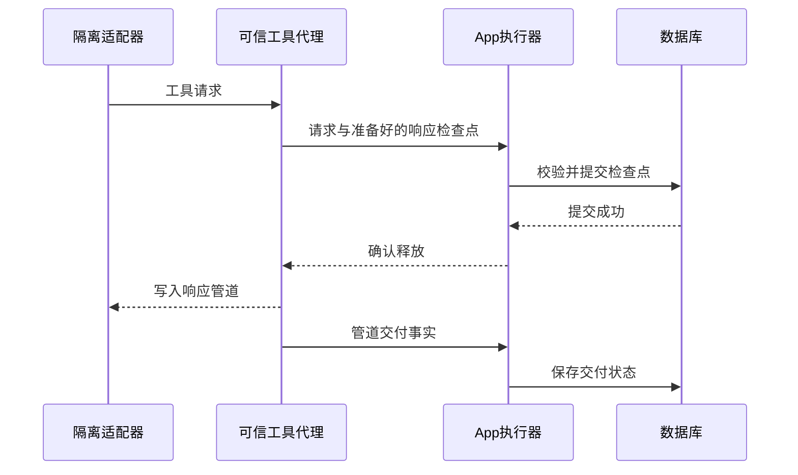

# 工具响应检查点与原生加载验收

日期：2026-10-20（跨日开发）。完整UI-00→QA-07、15Tasks/8KnownGaps继续开放。

## 已实现

可信工具代理将请求、响应准备与管道交付分别发到父监督器。父端先验证严格结构、顺序、资源权限与SHA，再调用持久化回调；数据库事务成功后才通过专用匿名确认管道释放响应。待测脚本不继承该确认管道或其环境变量。

- 每个Run最多8条请求检查点；输入摘要、case/序号、请求/响应、计划和Run标识、释放授权及准备时间绑定摘要。重复、越序、变更请求或非法权限不确认。
- 状态区分withheld、unknown、written_to_pipe。写入管道不证明脚本已处理；中断前缀不证明实际总量，也不自动重发。模型与主机工具权限没有扩大。
- 实时数据库记录、正常/取消后的产物、进程死亡后的显式interrupted恢复均保留已提交检查点。响应释放被撤销或写库失败时扣住响应。
- UI可在当前测试记录展开已保存检查点；即使没有最终产物，也能查看已知前缀。原本的完整Run证据入口保留。

## 并发存储锁故障与修正

新并发测试暴露偶发相对目录句柄打开锁文件的ENOENT。保留的诊断显示：目录句柄与路径inode相同、目录链接数正常、锁文件存在，绝对路径打开成功；没有证据把它归因到某个系统/Python缺陷，也未发现跨线程关闭目录描述符的诊断断言。

open_runtime_lock现仅对两个固定运行锁名执行最多3次打开尝试；每次使用同一固定目录句柄、O_NOFOLLOW及原私有权限。每次尝试前后重新核验完整路径无符号链接、路径与句柄仍是原inode。没有绝对路径回退，没有重跑任务；目录替换/持续故障/符号链接仍失败，原文件owner/mode/nlink、flock与锁文件inode检查保留。

修正前失败及诊断保存在build/agent-tool-checkpoint-recovery-20261019.log、checkpoint-concurrency-diagnostic、checkpoint-directory-repeat-1等同前缀日志；诊断插件只在指定诊断运行中启用，最终验收未使用它。修正后3个独立目录重复7项检查均通过（3.00/2.95/2.76秒），包含8线程64次实时读取及真实取消。

## 当前验收证据

- build/agent-tool-checkpoints-final-regression-20261020.log：193 passed/1依赖警告/55.65秒。含真实父执行进程死亡、检查点仍可读取且恢复不重发；真实取消；写库失败扣响应；准备后撤销保留withheld；损坏摘要409；流拆包/顺序/重复及原三个场景、共享隔离、存储访问/迁移/分阶段复制/重定位、原工作台和Web3调用。
- build/agent-tool-checkpoints-ui-20261020.log：实际API UI三场景及检查点展开、精确Run、193相关业务范围内的既有界面交互，以及18页/5页签/144显示组合通过，0模型调用，进程exit0。此UI检查不代表执行193个UI场景。
- 12文件在最终检查期间SHA一致：build/agent-tool-checkpoints-source-before-20261020.json与after。JS语法与git diff --check通过。

## 本机App已加载

Mac已解锁。主库只读确认无活动Run/租约/复验，随后通过原生正常退出；curl确认后端连接拒绝（exit7），再启动/Applications/Fieldwork.app，版本仍0.68.76/build154。本轮没有重建二进制，加载当前Python/JS文件。

CUA逐一打开18个导航页，观察到对应标题且未见读取错误；5个Agent子页可选且未见读取错误。攻击测试的新申请/三场景说明及适配器配置已在原生显示，最后停留该页并展开适配器配置，未填写或保存数据。

build/checkpoint-native-ui-acceptance-20261020.json保存这一导航验收摘要；main-before/after JSON确认Provider metadata摘要相同、主库runtime_calls=0与agent_attack_tests_v5=0。未在主库运行夹具、改模型或调用付费服务。这里是一次现有数据正常重启/页面入口检查，不是三次干净启动或原生真实测试链。

## 仍未完成

检查点是可校验的已保存事实前缀，尚非不可变独立行为回执；没有确认真实主机工具效果、外部/模型Agent质量或候选晋升。主机全行为/长期记忆、完整持久队列租约Worker与正式独立验证继续开放。底层偶发openat现象的系统归因未完成；有限重试处理后当前压力与相关验收通过，不宣称覆盖所有文件系统故障。

本机App加载不构成独立安装包、签名公证或正式发布验收。其余三域质量/规模/通知/迁移激活等原目标保持。无Git提交或推送。
